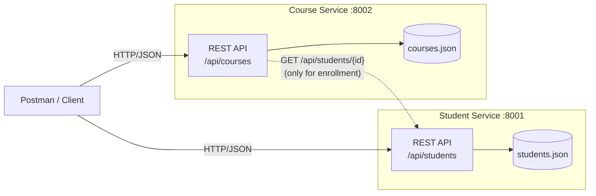
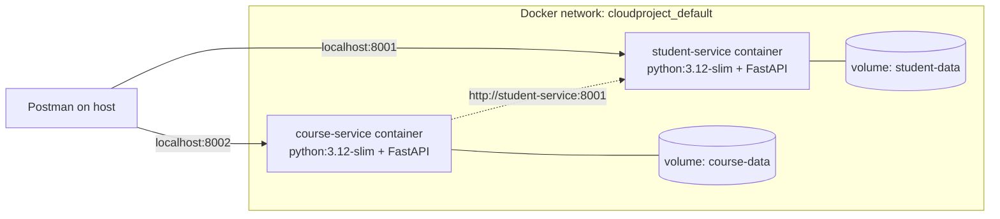

# Student & Course Microservices

**Cloud and Distributed Computing: Mini Project**

A simple application built from **two independent microservices**, one for **Students** and one for **Courses**. Each is a separate REST API with its own process, port and data store. Both can be accessed and tested independently using **Postman**.

| | Student Service | Course Service |
|---|---|---|
| Port | `8001` | `8002` |
| Base URL | `http://localhost:8001/api/students` | `http://localhost:8002/api/courses` |
| Swagger docs | http://localhost:8001/docs | http://localhost:8002/docs |
| Data store | `student-service/data/students.json` | `course-service/data/courses.json` |
| Tech | Python 3.10+, FastAPI, Pydantic, Uvicorn | same stack, deployed separately |
| Container | `cloudproject-student-service-1` | `cloudproject-course-service-1` |

> **Recording the demo or taking screenshots?** Do sections 3 and 4 to set up and start the services, then follow **[section 7, Step-by-step demo and test cases](#7-step-by-step-demo-and-test-cases)**. It lists every request to send, what to type, and the result you should see.

---

## 1. Architecture



The design follows these microservice principles:

- **Independent deployment.** Each service is its own process with its own port, its own `requirements.txt` and its own `Dockerfile`. Either one can be started, stopped, or redeployed without touching the other.
- **Database per service.** Each service owns a private data file. The Course Service never reads `students.json` directly.
- **Communication only over REST.** When a student is enrolled in a course, the Course Service asks the Student Service through its public API (`GET /api/students/{id}`) whether the student exists.
- **Fault isolation.** If the Student Service is down, only enrollment fails, with `503 Service Unavailable`. All other Course Service operations keep working.
- **Self-identifying responses.** Every response carries an `X-Service-Name` header, which proves in Postman which service answered, and an `X-Response-Time` header.

## 2. Project structure

```
Cloud Project/
├── student-service/            # Microservice 1
│   ├── app/
│   │   ├── main.py             # REST endpoints
│   │   ├── schemas.py          # request/response validation models
│   │   ├── store.py            # JSON-file repository (own data store)
│   │   └── seed.py             # sample students
│   ├── tests/test_students.py  # automated tests
│   ├── requirements.txt
│   └── Dockerfile
├── course-service/             # Microservice 2
│   ├── app/
│   │   ├── main.py             # REST endpoints + enrollment
│   │   ├── schemas.py
│   │   ├── store.py
│   │   ├── student_client.py   # REST client used to call the Student Service
│   │   └── seed.py             # sample courses
│   ├── tests/test_courses.py
│   ├── requirements.txt
│   └── Dockerfile
├── postman/Student-Course-Microservices.postman_collection.json
├── start-student-service.bat   # double-click to run service 1
├── start-course-service.bat    # double-click to run service 2
├── run_all.py                  # start both from one terminal
└── docker-compose.yml          # optional: run both as containers
```

`store.py` is deliberately duplicated in both services rather than shared. Microservices should not share code libraries or data that would couple their deployments.

## 3. Setup (one time)

**You need:**

- **Python 3.10 or newer.** Check with `python --version`.
- **Postman.** The desktop app is free.
- **Git**, to download the project.
- **Docker Desktop** is optional. You only need it for the container option in section 4.

**Download the project and install its packages:**

```bash
git clone https://github.com/Varuun06/Cloud-Computing.git
cd Cloud-Computing
python -m venv .venv
.venv\Scripts\activate            # Windows  (Linux/Mac: source .venv/bin/activate)
pip install -r student-service/requirements.txt -r course-service/requirements.txt
```

You only do this once. If the `.venv` folder already exists, skip the `python -m venv .venv` line. Running it again while the environment is active gives a "Permission denied" error, which is harmless. Next time, just run `.venv\Scripts\activate`.

## 4. Running the services

**Option A: two terminals (best for the demo).** Use this when you want to stop one service and show the other still works.

```bash
# Terminal 1
cd student-service
uvicorn app.main:app --port 8001

# Terminal 2
cd course-service
uvicorn app.main:app --port 8002
```

On Windows you can just double-click `start-student-service.bat` and `start-course-service.bat`.

**Option B: one command.** Run `python run_all.py`.

On first start, each service creates its data file with sample data. To reset to the sample data, stop the services and delete the `data/` folders.

**Option C: Docker containers.** This option needs Docker Desktop to be running, but it does not need the Python setup from section 3.

```bash
docker compose up --build -d          # build both images and start both containers
docker compose ps                     # show both containers running
docker compose logs -f                # watch live request logs from both services
docker compose down                   # stop and remove containers (data is kept)
docker compose down -v                # also delete the data volumes (reset to sample data)
```

Don't run Option A or B at the same time as Docker. They all use ports 8001 and 8002.

## 4a. How the Docker deployment works



- **One image per service.** `student-service/Dockerfile` and `course-service/Dockerfile` each build a separate image from `python:3.12-slim`. Each image contains only its own code and dependencies.
- **One container per service.** Each container can be stopped, restarted, or rebuilt without affecting the other.
- **Service discovery by name.** Docker Compose puts both containers on a private network and gives each one a DNS name. The Course Service finds the Student Service at `http://student-service:8001`, which is set through the `STUDENT_SERVICE_URL` environment variable in `docker-compose.yml`. The address is not hard-coded.
- **Persistent storage per service.** Each container writes to its own named volume (`student-data`, `course-data`). This is the database-per-service pattern, and records survive container restarts.
- **Port mapping.** Ports `8001` and `8002` are published to the host, so Postman on your machine can reach both containers.

This setup has been verified. The full Postman collection (24 requests, 59 checks) passes against the containers.

## 5. API reference

### Student Service (port 8001)

| Method | Endpoint | Description | Success |
|---|---|---|---|
| GET | `/` | Service info and links | 200 |
| GET | `/health` | Service health and record count | 200 |
| GET | `/api/students` | List all students. Optional filters: `?department=IT&year=4&search=priya` | 200 |
| GET | `/api/students/{id}` | Get one student | 200 |
| POST | `/api/students` | Create a student | 201 |
| PUT | `/api/students/{id}` | Update the supplied fields | 200 |
| DELETE | `/api/students/{id}` | Delete a student | 200 |

Sample body for `POST /api/students`:

```json
{
  "register_number": "312222205099",
  "name": "Varuun K",
  "email": "varuun2210@ssn.edu.in",
  "department": "IT",
  "year": 4,
  "cgpa": 8.7,
  "phone": "9876543210"
}
```

Validation rules:

- `register_number` must be 12 digits and unique.
- `email` must be a valid email address and unique.
- `year` must be between 1 and 4.
- `cgpa` must be between 0 and 10. It is optional.
- `phone` must be 10 to 13 digits. It is optional.

#### Request and response examples

These are real responses captured from the running service, using the sample data. Click a route to expand it. IDs and timestamps will differ on your machine.

<details>
<summary><b>1. Service info: <code>GET /</code></b></summary>

**Request**

```http
GET http://localhost:8001/
```

**Response:** `200 OK`

```json
{
  "service": "student-service",
  "docs": "/docs",
  "health": "/health",
  "api": "/api/students"
}
```

</details>

<details>
<summary><b>2. Health check: <code>GET /health</code></b></summary>

**Request**

```http
GET http://localhost:8001/health
```

**Response:** `200 OK`

```json
{
  "service": "student-service",
  "status": "UP",
  "uptime_seconds": 3725.4,
  "total_students": 4
}
```

</details>

<details>
<summary><b>3. List all students: <code>GET /api/students</code></b></summary>

**Request**

```http
GET http://localhost:8001/api/students
```

**Response:** `200 OK`

```json
{
  "count": 4,
  "data": [
    {
      "register_number": "312222205001",
      "name": "Aarav Krishnan",
      "email": "aarav2210@ssn.edu.in",
      "department": "IT",
      "year": 4,
      "cgpa": 8.9,
      "phone": "9840012345",
      "id": "S1001",
      "created_at": "2026-07-01T09:00:00+00:00",
      "updated_at": "2026-07-01T09:00:00+00:00"
    },
    {
      "register_number": "312222205002",
      "name": "Priya Ramesh",
      "email": "priya2210@ssn.edu.in",
      "department": "IT",
      "year": 4,
      "cgpa": 9.2,
      "phone": "9840023456",
      "id": "S1002",
      "created_at": "2026-07-01T09:00:00+00:00",
      "updated_at": "2026-07-01T09:00:00+00:00"
    },
    {
      "register_number": "312222104010",
      "name": "Karthik Subramanian",
      "email": "karthik2210@ssn.edu.in",
      "department": "CSE",
      "year": 4,
      "cgpa": 8.1,
      "phone": null,
      "id": "S1003",
      "created_at": "2026-07-01T09:00:00+00:00",
      "updated_at": "2026-07-01T09:00:00+00:00"
    },
    {
      "register_number": "312223205015",
      "name": "Divya Lakshmi",
      "email": "divya2310@ssn.edu.in",
      "department": "IT",
      "year": 3,
      "cgpa": 8.6,
      "phone": "9840034567",
      "id": "S1004",
      "created_at": "2026-07-01T09:00:00+00:00",
      "updated_at": "2026-07-01T09:00:00+00:00"
    }
  ]
}
```

</details>

<details>
<summary><b>4. Filter and search students: <code>GET /api/students?department=IT&amp;year=4</code></b></summary>

Filters can be combined. `search` matches part of a name or register number, for example `?search=priya`.

**Request**

```http
GET http://localhost:8001/api/students?department=IT&year=4
```

**Response:** `200 OK`

```json
{
  "count": 2,
  "data": [
    {
      "register_number": "312222205001",
      "name": "Aarav Krishnan",
      "email": "aarav2210@ssn.edu.in",
      "department": "IT",
      "year": 4,
      "cgpa": 8.9,
      "phone": "9840012345",
      "id": "S1001",
      "created_at": "2026-07-01T09:00:00+00:00",
      "updated_at": "2026-07-01T09:00:00+00:00"
    },
    {
      "register_number": "312222205002",
      "name": "Priya Ramesh",
      "email": "priya2210@ssn.edu.in",
      "department": "IT",
      "year": 4,
      "cgpa": 9.2,
      "phone": "9840023456",
      "id": "S1002",
      "created_at": "2026-07-01T09:00:00+00:00",
      "updated_at": "2026-07-01T09:00:00+00:00"
    }
  ]
}
```

</details>

<details>
<summary><b>5. Get one student: <code>GET /api/students/{id}</code></b></summary>

**Request**

```http
GET http://localhost:8001/api/students/S1002
```

**Response:** `200 OK`

```json
{
  "register_number": "312222205002",
  "name": "Priya Ramesh",
  "email": "priya2210@ssn.edu.in",
  "department": "IT",
  "year": 4,
  "cgpa": 9.2,
  "phone": "9840023456",
  "id": "S1002",
  "created_at": "2026-07-01T09:00:00+00:00",
  "updated_at": "2026-07-01T09:00:00+00:00"
}
```

</details>

<details>
<summary><b>6. Create a student: <code>POST /api/students</code></b></summary>

The response also includes a `Location: /api/students/S1005` header.

**Request**

```http
POST http://localhost:8001/api/students
Content-Type: application/json

{
  "register_number": "312222205099",
  "name": "Varuun K",
  "email": "varuun2210@ssn.edu.in",
  "department": "IT",
  "year": 4,
  "cgpa": 8.7,
  "phone": "9876543210"
}
```

**Response:** `201 Created`

```json
{
  "register_number": "312222205099",
  "name": "Varuun K",
  "email": "varuun2210@ssn.edu.in",
  "department": "IT",
  "year": 4,
  "cgpa": 8.7,
  "phone": "9876543210",
  "id": "S1005",
  "created_at": "2026-10-06T17:32:34+00:00",
  "updated_at": "2026-10-06T17:32:34+00:00"
}
```

</details>

<details>
<summary><b>7. Update a student: <code>PUT /api/students/{id}</code></b></summary>

Only the fields you send are changed. Everything else stays the same.

**Request**

```http
PUT http://localhost:8001/api/students/S1005
Content-Type: application/json

{
  "cgpa": 9.1,
  "phone": "9123456789"
}
```

**Response:** `200 OK`

```json
{
  "register_number": "312222205099",
  "name": "Varuun K",
  "email": "varuun2210@ssn.edu.in",
  "department": "IT",
  "year": 4,
  "cgpa": 9.1,
  "phone": "9123456789",
  "id": "S1005",
  "created_at": "2026-10-06T17:32:34+00:00",
  "updated_at": "2026-10-06T17:32:34+00:00"
}
```

</details>

<details>
<summary><b>8. Delete a student: <code>DELETE /api/students/{id}</code></b></summary>

**Request**

```http
DELETE http://localhost:8001/api/students/S1005
```

**Response:** `200 OK`

```json
{
  "message": "Student S1005 deleted",
  "data": {
    "register_number": "312222205099",
    "name": "Varuun K",
    "email": "varuun2210@ssn.edu.in",
    "department": "IT",
    "year": 4,
    "cgpa": 9.1,
    "phone": "9123456789",
    "id": "S1005",
    "created_at": "2026-10-06T17:32:34+00:00",
    "updated_at": "2026-10-06T17:32:34+00:00"
  }
}
```

</details>

#### Error examples

<details>
<summary><b>9. Validation error (422)</b></summary>

Every invalid field is listed, each with the reason.

**Request**

```http
POST http://localhost:8001/api/students
Content-Type: application/json

{
  "register_number": "123",
  "name": "Test",
  "email": "not-an-email",
  "department": "IT",
  "year": 7
}
```

**Response:** `422 Unprocessable Entity`

```json
{
  "detail": [
    {
      "type": "string_pattern_mismatch",
      "loc": [
        "body",
        "register_number"
      ],
      "msg": "String should match pattern '^\\d{12}$'",
      "input": "123",
      "ctx": {
        "pattern": "^\\d{12}$"
      }
    },
    {
      "type": "string_pattern_mismatch",
      "loc": [
        "body",
        "email"
      ],
      "msg": "String should match pattern '^[^\\s@]+@[^\\s@]+\\.[^\\s@]+$'",
      "input": "not-an-email",
      "ctx": {
        "pattern": "^[^\\s@]+@[^\\s@]+\\.[^\\s@]+$"
      }
    },
    {
      "type": "less_than_equal",
      "loc": [
        "body",
        "year"
      ],
      "msg": "Input should be less than or equal to 4",
      "input": 7,
      "ctx": {
        "le": 4
      }
    }
  ]
}
```

</details>

<details>
<summary><b>10. Duplicate register number or email (409)</b></summary>

**Request**

```http
POST http://localhost:8001/api/students
Content-Type: application/json

{
  "register_number": "312222205001",
  "name": "Varuun K",
  "email": "someone@ssn.edu.in",
  "department": "IT",
  "year": 4,
  "cgpa": 8.7,
  "phone": "9876543210"
}
```

**Response:** `409 Conflict`

```json
{
  "detail": "Register number or email already used by student S1001"
}
```

</details>

<details>
<summary><b>11. Student not found (404)</b></summary>

**Request**

```http
GET http://localhost:8001/api/students/S9999
```

**Response:** `404 Not Found`

```json
{
  "detail": "Student S9999 not found"
}
```

</details>

<details>
<summary><b>12. Empty update body (400)</b></summary>

**Request**

```http
PUT http://localhost:8001/api/students/S1001
Content-Type: application/json

{}
```

**Response:** `400 Bad Request`

```json
{
  "detail": "Provide at least one field to update"
}
```

</details>

### Course Service (port 8002)

| Method | Endpoint | Description | Success |
|---|---|---|---|
| GET | `/` | Service info and links | 200 |
| GET | `/health` | Service health and record count | 200 |
| GET | `/api/courses` | List all courses. Optional filters: `?department=IT&semester=7&search=cloud` | 200 |
| GET | `/api/courses/{id}` | Get one course, including `seats_available` | 200 |
| POST | `/api/courses` | Create a course | 201 |
| PUT | `/api/courses/{id}` | Update the supplied fields | 200 |
| DELETE | `/api/courses/{id}` | Delete a course | 200 |
| GET | `/api/courses/{id}/enrollments` | List the IDs of enrolled students | 200 |
| POST | `/api/courses/{id}/enrollments` | Enroll a student, with body `{"student_id": "S1001"}`. This calls the Student Service. | 201 |
| DELETE | `/api/courses/{id}/enrollments/{student_id}` | Unenroll a student | 200 |

Sample body for `POST /api/courses`:

```json
{
  "code": "IT1705",
  "title": "Internet of Things",
  "credits": 3,
  "department": "IT",
  "semester": 7,
  "instructor": "Dr. S. Meena",
  "capacity": 60
}
```

#### Request and response examples

These are real responses captured from the running service, using the sample data. Click a route to expand it. IDs and timestamps will differ on your machine.

<details>
<summary><b>1. Service info: <code>GET /</code></b></summary>

**Request**

```http
GET http://localhost:8002/
```

**Response:** `200 OK`

```json
{
  "service": "course-service",
  "docs": "/docs",
  "health": "/health",
  "api": "/api/courses"
}
```

</details>

<details>
<summary><b>2. Health check: <code>GET /health</code></b></summary>

**Request**

```http
GET http://localhost:8002/health
```

**Response:** `200 OK`

```json
{
  "service": "course-service",
  "status": "UP",
  "uptime_seconds": 3721.8,
  "total_courses": 3
}
```

</details>

<details>
<summary><b>3. List all courses: <code>GET /api/courses</code></b></summary>

**Request**

```http
GET http://localhost:8002/api/courses
```

**Response:** `200 OK`

```json
{
  "count": 3,
  "data": [
    {
      "code": "IT1701",
      "title": "Cloud and Distributed Computing",
      "credits": 3,
      "department": "IT",
      "semester": 7,
      "instructor": "Dr. R. Priyadharshini",
      "capacity": 60,
      "id": "C101",
      "enrolled_students": [
        "S1001",
        "S1002"
      ],
      "seats_available": 58,
      "created_at": "2026-07-01T09:00:00+00:00",
      "updated_at": "2026-07-01T09:00:00+00:00"
    },
    {
      "code": "IT1702",
      "title": "Machine Learning Techniques",
      "credits": 3,
      "department": "IT",
      "semester": 7,
      "instructor": "Dr. K. Arun",
      "capacity": 60,
      "id": "C102",
      "enrolled_students": [
        "S1002"
      ],
      "seats_available": 59,
      "created_at": "2026-07-01T09:00:00+00:00",
      "updated_at": "2026-07-01T09:00:00+00:00"
    },
    {
      "code": "CS1704",
      "title": "Cryptography and Network Security",
      "credits": 4,
      "department": "CSE",
      "semester": 7,
      "instructor": "Dr. M. Sanjay",
      "capacity": 2,
      "id": "C103",
      "enrolled_students": [
        "S1003"
      ],
      "seats_available": 1,
      "created_at": "2026-07-01T09:00:00+00:00",
      "updated_at": "2026-07-01T09:00:00+00:00"
    }
  ]
}
```

</details>

<details>
<summary><b>4. Filter and search courses: <code>GET /api/courses?department=IT&amp;search=cloud</code></b></summary>

Filters: `department`, `semester` (1-8) and `search` (matches part of the title or code).

**Request**

```http
GET http://localhost:8002/api/courses?department=IT&search=cloud
```

**Response:** `200 OK`

```json
{
  "count": 1,
  "data": [
    {
      "code": "IT1701",
      "title": "Cloud and Distributed Computing",
      "credits": 3,
      "department": "IT",
      "semester": 7,
      "instructor": "Dr. R. Priyadharshini",
      "capacity": 60,
      "id": "C101",
      "enrolled_students": [
        "S1001",
        "S1002"
      ],
      "seats_available": 58,
      "created_at": "2026-07-01T09:00:00+00:00",
      "updated_at": "2026-07-01T09:00:00+00:00"
    }
  ]
}
```

</details>

<details>
<summary><b>5. Get one course: <code>GET /api/courses/{id}</code></b></summary>

**Request**

```http
GET http://localhost:8002/api/courses/C101
```

**Response:** `200 OK`

```json
{
  "code": "IT1701",
  "title": "Cloud and Distributed Computing",
  "credits": 3,
  "department": "IT",
  "semester": 7,
  "instructor": "Dr. R. Priyadharshini",
  "capacity": 60,
  "id": "C101",
  "enrolled_students": [
    "S1001",
    "S1002"
  ],
  "seats_available": 58,
  "created_at": "2026-07-01T09:00:00+00:00",
  "updated_at": "2026-07-01T09:00:00+00:00"
}
```

</details>

<details>
<summary><b>6. Create a course: <code>POST /api/courses</code></b></summary>

The response also includes a `Location: /api/courses/C104` header.

**Request**

```http
POST http://localhost:8002/api/courses
Content-Type: application/json

{
  "code": "IT1705",
  "title": "Internet of Things",
  "credits": 3,
  "department": "IT",
  "semester": 7,
  "instructor": "Dr. S. Meena",
  "capacity": 60
}
```

**Response:** `201 Created`

```json
{
  "code": "IT1705",
  "title": "Internet of Things",
  "credits": 3,
  "department": "IT",
  "semester": 7,
  "instructor": "Dr. S. Meena",
  "capacity": 60,
  "id": "C104",
  "enrolled_students": [],
  "seats_available": 60,
  "created_at": "2026-10-06T17:32:35+00:00",
  "updated_at": "2026-10-06T17:32:35+00:00"
}
```

</details>

<details>
<summary><b>7. Update a course: <code>PUT /api/courses/{id}</code></b></summary>

Only the fields you send are changed. `seats_available` is recalculated automatically.

**Request**

```http
PUT http://localhost:8002/api/courses/C104
Content-Type: application/json

{
  "instructor": "Dr. P. Kumar",
  "capacity": 40
}
```

**Response:** `200 OK`

```json
{
  "code": "IT1705",
  "title": "Internet of Things",
  "credits": 3,
  "department": "IT",
  "semester": 7,
  "instructor": "Dr. P. Kumar",
  "capacity": 40,
  "id": "C104",
  "enrolled_students": [],
  "seats_available": 40,
  "created_at": "2026-10-06T17:32:35+00:00",
  "updated_at": "2026-10-06T17:32:35+00:00"
}
```

</details>

<details>
<summary><b>8. Delete a course: <code>DELETE /api/courses/{id}</code></b></summary>

**Request**

```http
DELETE http://localhost:8002/api/courses/C104
```

**Response:** `200 OK`

```json
{
  "message": "Course C104 deleted",
  "data": {
    "code": "IT1705",
    "title": "Internet of Things",
    "credits": 3,
    "department": "IT",
    "semester": 7,
    "instructor": "Dr. P. Kumar",
    "capacity": 40,
    "id": "C104",
    "enrolled_students": [],
    "seats_available": 40,
    "created_at": "2026-10-06T17:32:35+00:00",
    "updated_at": "2026-10-06T17:32:35+00:00"
  }
}
```

</details>

<details>
<summary><b>9. Enroll a student: <code>POST /api/courses/{id}/enrollments</code></b></summary>

The Course Service calls `GET http://localhost:8001/api/students/S1004` on the Student Service to confirm the student exists. That is where `student_name` comes from.

**Request**

```http
POST http://localhost:8002/api/courses/C101/enrollments
Content-Type: application/json

{
  "student_id": "S1004"
}
```

**Response:** `201 Created`

```json
{
  "message": "Divya Lakshmi enrolled in IT1701",
  "course_id": "C101",
  "student_id": "S1004",
  "student_name": "Divya Lakshmi",
  "enrolled_count": 3,
  "seats_available": 57
}
```

</details>

<details>
<summary><b>10. List enrollments: <code>GET /api/courses/{id}/enrollments</code></b></summary>

**Request**

```http
GET http://localhost:8002/api/courses/C101/enrollments
```

**Response:** `200 OK`

```json
{
  "course_id": "C101",
  "course_code": "IT1701",
  "count": 3,
  "student_ids": [
    "S1001",
    "S1002",
    "S1004"
  ]
}
```

</details>

<details>
<summary><b>11. Unenroll a student: <code>DELETE /api/courses/{id}/enrollments/{student_id}</code></b></summary>

**Request**

```http
DELETE http://localhost:8002/api/courses/C101/enrollments/S1004
```

**Response:** `200 OK`

```json
{
  "message": "Student S1004 removed from IT1701",
  "course_id": "C101",
  "student_id": "S1004",
  "student_name": null,
  "enrolled_count": 2,
  "seats_available": 58
}
```

</details>

#### Error examples

<details>
<summary><b>12. Validation error (422)</b></summary>

**Request**

```http
POST http://localhost:8002/api/courses
Content-Type: application/json

{
  "code": "bad code",
  "title": "Internet of Things",
  "credits": 9,
  "department": "IT",
  "semester": 7,
  "instructor": "Dr. S. Meena",
  "capacity": 60
}
```

**Response:** `422 Unprocessable Entity`

```json
{
  "detail": [
    {
      "type": "string_pattern_mismatch",
      "loc": [
        "body",
        "code"
      ],
      "msg": "String should match pattern '^[A-Z]{2,4}\\d{3,4}$'",
      "input": "bad code",
      "ctx": {
        "pattern": "^[A-Z]{2,4}\\d{3,4}$"
      }
    },
    {
      "type": "less_than_equal",
      "loc": [
        "body",
        "credits"
      ],
      "msg": "Input should be less than or equal to 5",
      "input": 9,
      "ctx": {
        "le": 5
      }
    }
  ]
}
```

</details>

<details>
<summary><b>13. Duplicate course code (409)</b></summary>

**Request**

```http
POST http://localhost:8002/api/courses
Content-Type: application/json

{
  "code": "IT1701",
  "title": "Internet of Things",
  "credits": 3,
  "department": "IT",
  "semester": 7,
  "instructor": "Dr. S. Meena",
  "capacity": 60
}
```

**Response:** `409 Conflict`

```json
{
  "detail": "Course code IT1701 already exists"
}
```

</details>

<details>
<summary><b>14. Capacity below enrolled count (409)</b></summary>

**Request**

```http
PUT http://localhost:8002/api/courses/C101
Content-Type: application/json

{
  "capacity": 1
}
```

**Response:** `409 Conflict`

```json
{
  "detail": "Capacity cannot be below the 2 students already enrolled"
}
```

</details>

<details>
<summary><b>15. Student does not exist (404)</b></summary>

**Request**

```http
POST http://localhost:8002/api/courses/C101/enrollments
Content-Type: application/json

{
  "student_id": "S9999"
}
```

**Response:** `404 Not Found`

```json
{
  "detail": "Student S9999 does not exist in the Student Service"
}
```

</details>

<details>
<summary><b>16. Student already enrolled (409)</b></summary>

**Request**

```http
POST http://localhost:8002/api/courses/C101/enrollments
Content-Type: application/json

{
  "student_id": "S1001"
}
```

**Response:** `409 Conflict`

```json
{
  "detail": "Student S1001 is already enrolled in IT1701"
}
```

</details>

<details>
<summary><b>17. Course full (409)</b></summary>

`C103` has a capacity of 2, and both seats are taken.

**Request**

```http
POST http://localhost:8002/api/courses/C103/enrollments
Content-Type: application/json

{
  "student_id": "S1002"
}
```

**Response:** `409 Conflict`

```json
{
  "detail": "Course CS1704 is full"
}
```

</details>

<details>
<summary><b>18. Student Service is down (503)</b></summary>

This is what you get when the Student Service is stopped. Only enrollment is affected. Every other Course Service route keeps working.

**Request**

```http
POST http://localhost:8002/api/courses/C102/enrollments
Content-Type: application/json

{
  "student_id": "S1004"
}
```

**Response:** `503 Service Unavailable`

```json
{
  "detail": "Cannot verify student right now - Student Service unreachable at http://127.0.0.1:8001: ConnectError"
}
```

</details>

<details>
<summary><b>19. Course not found (404)</b></summary>

**Request**

```http
GET http://localhost:8002/api/courses/C999
```

**Response:** `404 Not Found`

```json
{
  "detail": "Course C999 not found"
}
```

</details>

### Status codes used

| Code | Meaning |
|---|---|
| 200 / 201 | OK / Created (`201` also returns a `Location` header) |
| 400 | Empty update body |
| 404 | Resource not found |
| 409 | Conflict: duplicate register number, email or course code; course full; already enrolled; capacity set below the enrolled count |
| 422 | Validation failed. The response lists every invalid field. |
| 503 | Student Service unreachable (enrollment only) |

## 6. Demonstrating with Postman

1. Start both services (section 4).
2. In Postman, choose **Import** and select `postman/Student-Course-Microservices.postman_collection.json`.
3. The collection has four folders:
   - **1. Student Service**: health, list, filter, create, get, update, plus error cases (422, 409, 404). These requests hit only port 8001.
   - **2. Course Service**: the same operations for courses. These requests hit only port 8002.
   - **3. Enrollment**: shows the two services talking to each other over REST.
   - **4. Cleanup**: deletes the records you created.
4. Click the collection, then **Run**, to execute all 24 requests. Each request has built-in test assertions (59 in total), and all of them pass.
5. Open any response and look at the **Headers** tab. `X-Service-Name` shows which microservice answered.

The `Create` requests save the new IDs into collection variables (`{{new_student_id}}` and `{{new_course_id}}`), so the requests that follow use them automatically.

### Showing that the services are independent (do this live in the viva)

1. **Stop the Course Service** (Ctrl+C in terminal 2). Run folder 1 in Postman. Every Student Service request still works.
2. Start the Course Service again and **stop the Student Service** instead. Run folder 2. Every Course Service request still works.
3. With the Student Service still stopped, run **Enroll student in course**. You get:
   ```json
   {"detail": "Cannot verify student right now - Student Service unreachable at http://127.0.0.1:8001: ConnectError"}
   ```
   This is a `503` response. The failure stays contained in the one feature that depends on the other service. The Course Service does not crash.
4. Start the Student Service again. Enrollment works again without restarting the Course Service.

**The same demo with Docker.** Instead of pressing Ctrl+C, stop and start containers:

```bash
docker compose stop course-service     # Student Service requests still work
docker compose start course-service
docker compose stop student-service    # Course Service requests still work; enrollment returns 503
docker compose start student-service   # enrollment works again
```

In Docker, the 503 message reads `Student Service unreachable at http://student-service:8001`. Docker Desktop's **Containers** tab shows one container stopped and the other still running, which makes a good screenshot for your report.

## 7. Step-by-step demo and test cases

Use this section to record the demo video (5 to 7 minutes) and take the report screenshots. Send the requests in the order shown, because later steps rely on the records that earlier steps create. Every expected result below is the actual output from the sample data.

### 7.1 Before you start: reset the data

Each service saves its data to disk. If you have run the project before, reset the data so that IDs and counts match this guide. If you skip this, some steps will give different results; for example, step 12 would return 409 instead of 201.

```bash
# If you used Docker:
docker compose down -v

# If you ran the services locally (Command Prompt):
rmdir /s /q student-service\data course-service\data
# ...or in PowerShell:
Remove-Item -Recurse -Force student-service\data, course-service\data
```

If the `data` folders don't exist yet, the command shows an error. That's fine.

Then start both services using any option from section 4. The simplest is to double-click `start-student-service.bat` and `start-course-service.bat`.

**Postman tips:**

- For every **POST** and **PUT** request, go to **Body**, choose **raw**, then choose **JSON**, and paste the body.
- To see which service answered, open the **Headers** tab of the response and look at `X-Service-Name`.

### 7.2 Show that both services are running (video 0:45–1:45)

| Step | Method | URL | Expected result |
|---|---|---|---|
| 1 | GET | `http://localhost:8001/health` | `200 OK`, `"service": "student-service"`, `"status": "UP"`, `"total_students": 4` |
| 2 | GET | `http://localhost:8002/health` | `200 OK`, `"service": "course-service"`, `"status": "UP"`, `"total_courses": 3` |

Then open http://localhost:8001/docs and http://localhost:8002/docs in two browser tabs to show that each service has its own API documentation page.

### 7.3 Create, read, update and delete records (video 1:45–3:15)

**Student Service (port 8001)**

| Step | Method | URL | Body | Expected result |
|---|---|---|---|---|
| 3 | GET | `http://localhost:8001/api/students` | none | `200 OK`, `"count": 4` |
| 4 | GET | `http://localhost:8001/api/students?department=IT&year=4` | none | `200 OK`, `"count": 2`: S1001 Aarav Krishnan and S1002 Priya Ramesh. **Use this for Screenshot 1.** |
| 5 | POST | `http://localhost:8001/api/students` | Body A below | `201 Created`, `"id": "S1005"` |
| 6 | GET | `http://localhost:8001/api/students/S1005` | none | `200 OK`, the student you just created |
| 7 | PUT | `http://localhost:8001/api/students/S1005` | `{"cgpa": 9.1}` | `200 OK`, `"cgpa": 9.1`. All other fields are unchanged. |

Body A:

```json
{
  "register_number": "312222205099",
  "name": "Varuun K",
  "email": "varuun2210@ssn.edu.in",
  "department": "IT",
  "year": 4,
  "cgpa": 8.7,
  "phone": "9876543210"
}
```

**Course Service (port 8002)**

| Step | Method | URL | Body | Expected result |
|---|---|---|---|---|
| 8 | GET | `http://localhost:8002/api/courses?department=IT&semester=7` | none | `200 OK`, `"count": 2`: IT1701 and IT1702 |
| 9 | POST | `http://localhost:8002/api/courses` | Body B below | `201 Created`, `"id": "C104"`, `"seats_available": 60` |
| 10 | PUT | `http://localhost:8002/api/courses/C104` | `{"instructor": "Dr. P. Kumar", "capacity": 40}` | `200 OK`, `"instructor": "Dr. P. Kumar"`, `"seats_available": 40` |

Body B:

```json
{
  "code": "IT1705",
  "title": "Internet of Things",
  "credits": 3,
  "department": "IT",
  "semester": 7,
  "instructor": "Dr. S. Meena",
  "capacity": 60
}
```

### 7.4 Enroll students: the two services talk to each other (video 3:15–4:30)

| Step | Method | URL | Body | Expected result |
|---|---|---|---|---|
| 11 | GET | `http://localhost:8002/api/courses/C101` | none | `200 OK`, `"seats_available": 58` (2 students already enrolled) |
| 12 | POST | `http://localhost:8002/api/courses/C101/enrollments` | `{"student_id": "S1004"}` | `201 Created`, `"message": "Divya Lakshmi enrolled in IT1701"`, `"enrolled_count": 3`, `"seats_available": 57`. **Use this for Screenshot 2.** |
| 13 | GET | `http://localhost:8002/api/courses/C101/enrollments` | none | `200 OK`, `"student_ids": ["S1001", "S1002", "S1004"]` |
| 14 | POST | `http://localhost:8002/api/courses/C104/enrollments` | `{"student_id": "S1005"}` | `201 Created`. The student from step 5 is now in the course from step 9. |

**What to say during step 12:** the Course Service doesn't have student data. It called `GET http://localhost:8001/api/students/S1004` on the Student Service to check that the student exists. That is where `student_name` comes from.

For Screenshot 2, capture the response body, and if you can, also capture the **Headers** tab showing `X-Service-Name: course-service`.

### 7.5 Error cases (video 4:30–5:00)

| Step | Method | URL | Body | Expected result |
|---|---|---|---|---|
| 15 | POST | `http://localhost:8001/api/students` | Body C below | `422 Unprocessable Entity`, which lists 3 invalid fields: `register_number`, `email` and `year` |
| 16 | POST | `http://localhost:8002/api/courses/C101/enrollments` | `{"student_id": "S1004"}` | `409 Conflict`, `"Student S1004 is already enrolled in IT1701"` |
| 17 | POST | `http://localhost:8002/api/courses/C101/enrollments` | `{"student_id": "S9999"}` | `404 Not Found`, `"Student S9999 does not exist in the Student Service"` |

Body C (intentionally invalid):

```json
{
  "register_number": "123",
  "name": "Test",
  "email": "not-an-email",
  "department": "IT",
  "year": 7
}
```

### 7.6 Show that the services are independent (video 5:00–5:30)

**Stop the Student Service:**

- If you're running it locally, press **Ctrl+C** in the Student Service window.
- If you're using Docker, run `docker compose stop student-service`.

| Step | Method | URL | Body | Expected result |
|---|---|---|---|---|
| 18 | GET | `http://localhost:8001/health` | none | Postman shows **"Could not send request"** (connection refused), because the Student Service is down |
| 19 | GET | `http://localhost:8002/api/courses` | none | `200 OK`. **The Course Service still works.** |
| 20 | POST | `http://localhost:8002/api/courses/C102/enrollments` | `{"student_id": "S1004"}` | `503 Service Unavailable`, `"Cannot verify student right now - Student Service unreachable ..."`. Only the feature that needs the other service fails. |

**Start the Student Service again:**

- If you're running it locally, run the `.bat` file again.
- If you're using Docker, run `docker compose start student-service`.

| Step | Method | URL | Body | Expected result |
|---|---|---|---|---|
| 21 | POST | `http://localhost:8002/api/courses/C102/enrollments` | `{"student_id": "S1004"}` | `201 Created`. It recovers without restarting the Course Service. |

### 7.7 Clean up and run the automated tests (video 5:30–6:15)

| Step | Method | URL | Expected result |
|---|---|---|---|
| 22 | DELETE | `http://localhost:8002/api/courses/C104` | `200 OK`, `"Course C104 deleted"` |
| 23 | DELETE | `http://localhost:8001/api/students/S1005` | `200 OK`, `"Student S1005 deleted"` |
| 24 | GET | `http://localhost:8001/api/students/S1005` | `404 Not Found`, which confirms the delete worked |

Then run the automated tests (see section 8). The result should be **6 passed** for the Student Service and **8 passed** for the Course Service.

**Optional finish:** in Postman, import the collection (section 6), click it, and choose **Run**. You should see 24 requests with all 59 tests passing. Only do this **after step 24**, because the collection creates its own S1005 and C104.

### 7.8 Summary of all test cases (for the report)

| TC | Test case | Step | Expected |
|---|---|---|---|
| TC-01 | Student Service health check | 1 | 200 |
| TC-02 | Course Service health check | 2 | 200 |
| TC-03 | List all students | 3 | 200, 4 records |
| TC-04 | Filter students by department and year | 4 | 200, 2 records |
| TC-05 | Create student | 5 | 201 |
| TC-06 | Get student by ID | 6 | 200 |
| TC-07 | Update student | 7 | 200 |
| TC-08 | Filter courses by department and semester | 8 | 200, 2 records |
| TC-09 | Create course | 9 | 201 |
| TC-10 | Update course | 10 | 200 |
| TC-11 | Get course by ID | 11 | 200 |
| TC-12 | Enroll student (inter-service call) | 12 | 201 |
| TC-13 | List enrollments | 13 | 200 |
| TC-14 | Enroll newly created student | 14 | 201 |
| TC-15 | Invalid student input | 15 | 422 |
| TC-16 | Duplicate enrollment | 16 | 409 |
| TC-17 | Enroll a student who doesn't exist | 17 | 404 |
| TC-18 | Student Service stopped | 18 | Connection refused |
| TC-19 | Course Service works while Student Service is down | 19 | 200 |
| TC-20 | Enrollment while Student Service is down | 20 | 503 |
| TC-21 | Enrollment after Student Service restarts | 21 | 201 |
| TC-22 | Delete course | 22 | 200 |
| TC-23 | Delete student | 23 | 200 |
| TC-24 | Get deleted student | 24 | 404 |
| TC-25 | Automated tests: Student Service | section 8 | 6 passed |
| TC-26 | Automated tests: Course Service | section 8 | 8 passed |
| TC-27 | Postman collection run (optional) | section 6 | 24 requests, 59 assertions passed |

## 8. Automated tests

Run these from the project folder with the virtual environment activated:

```bash
cd student-service
python -m pytest -v        # expect: 6 passed
cd ..\course-service
python -m pytest -v        # expect: 8 passed
cd ..
```

Run each service's tests from inside its own folder, as shown, not both at once from the project folder.

The Course Service tests replace the Student Service with a fake client, so each service is tested on its own. One test (`test_fault_isolation_when_student_service_down`) checks the fault-isolation behaviour.

## 9. Sample data

| Students | | Courses | |
|---|---|---|---|
| S1001 | Aarav Krishnan (IT, 4th yr) | C101 | IT1701 Cloud and Distributed Computing |
| S1002 | Priya Ramesh (IT, 4th yr) | C102 | IT1702 Machine Learning Techniques |
| S1003 | Karthik Subramanian (CSE, 4th yr) | C103 | CS1704 Cryptography and Network Security (capacity 2, for testing "course full") |
| S1004 | Divya Lakshmi (IT, 3rd yr) | | |

## 10. Possible extensions

- An **API Gateway** (for example, Nginx or Kong) to give clients a single entry point.
- A **service registry and discovery** (for example, Consul or Eureka) instead of hard-coded URLs.
- A real database per service (PostgreSQL for students, MongoDB for courses), which would show *polyglot persistence*.
- Deployment to **Kubernetes** or a cloud platform (AWS ECS, Azure Container Apps). The existing Docker images could be pushed to a registry and deployed as they are.
- A **circuit breaker** and retries on the Course Service to Student Service call.
- JWT authentication.
