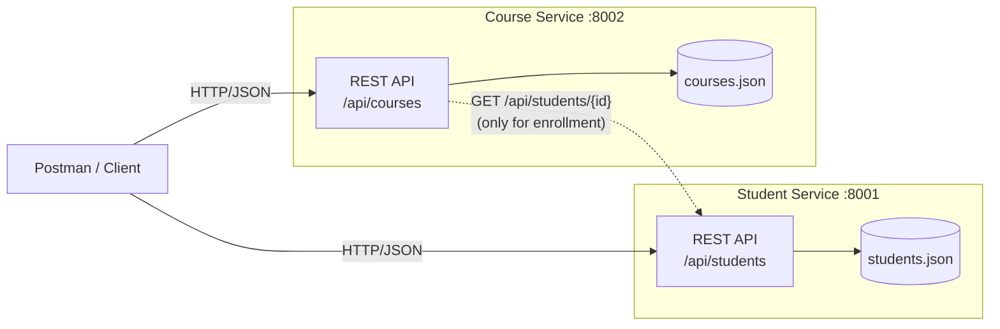
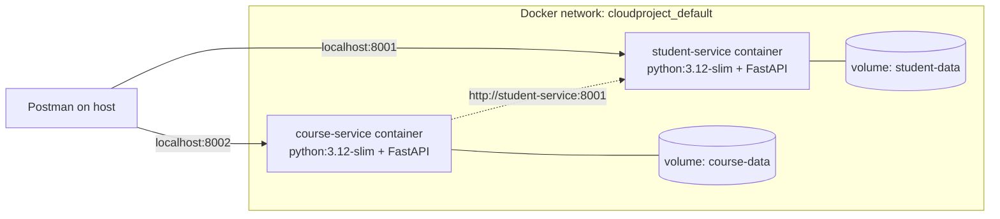

# Student & Course Microservices

**Cloud and Distributed Computing: Mini Project**

A simple application built from **two independent microservices**, one for **Students** and one for **Courses**. Each is a separate REST API with its own process, port and data store. Both can be accessed and tested independently using **Postman**.

| | Student Service | Course Service |
|---|---|---|
| Port | `8001` | `8002` |
| Base URL | `http://localhost:8001/api/students` | `http://localhost:8002/api/courses` |
| Swagger docs | http://localhost:8001/docs | http://localhost:8002/docs |
| Data store | `student-service/data/students.json` | `course-service/data/courses.json` |
| Tech | Python 3.10+, FastAPI, Pydantic, Uvicorn | same stack, deployed separately |
| Container | `cloudproject-student-service-1` | `cloudproject-course-service-1` |

---

## 1. Architecture



The design follows these microservice principles:

- **Independent deployment.** Each service is its own process with its own port, its own `requirements.txt` and its own `Dockerfile`. Either one can be started, stopped, or redeployed without touching the other.
- **Database per service.** Each service owns a private data file. The Course Service never reads `students.json` directly.
- **Communication only over REST.** When a student is enrolled in a course, the Course Service asks the Student Service through its public API (`GET /api/students/{id}`) whether the student exists.
- **Fault isolation.** If the Student Service is down, only enrollment fails, with `503 Service Unavailable`. All other Course Service operations keep working.
- **Self-identifying responses.** Every response carries an `X-Service-Name` header, which proves in Postman which service answered, and an `X-Response-Time` header.

## 2. Project structure

```
Cloud Project/
├── student-service/            # Microservice 1
│   ├── app/
│   │   ├── main.py             # REST endpoints
│   │   ├── schemas.py          # request/response validation models
│   │   ├── store.py            # JSON-file repository (own data store)
│   │   └── seed.py             # sample students
│   ├── tests/test_students.py  # automated tests
│   ├── requirements.txt
│   └── Dockerfile
├── course-service/             # Microservice 2
│   ├── app/
│   │   ├── main.py             # REST endpoints + enrollment
│   │   ├── schemas.py
│   │   ├── store.py
│   │   ├── student_client.py   # REST client used to call the Student Service
│   │   └── seed.py             # sample courses
│   ├── tests/test_courses.py
│   ├── requirements.txt
│   └── Dockerfile
├── postman/Student-Course-Microservices.postman_collection.json
├── start-student-service.bat   # double-click to run service 1
├── start-course-service.bat    # double-click to run service 2
├── run_all.py                  # start both from one terminal
└── docker-compose.yml          # optional: run both as containers
```

`store.py` is deliberately duplicated in both services rather than shared. Microservices should not share code libraries or data that would couple their deployments.

## 3. Setup (one time)

```bash
cd "Cloud Project"
python -m venv .venv
.venv\Scripts\activate            # Windows  (Linux/Mac: source .venv/bin/activate)
pip install -r student-service/requirements.txt -r course-service/requirements.txt
```

## 4. Running the services

**Option A: two terminals (best for the demo).** Use this when you want to stop one service and show the other still works.

```bash
# Terminal 1
cd student-service
uvicorn app.main:app --port 8001

# Terminal 2
cd course-service
uvicorn app.main:app --port 8002
```

On Windows you can just double-click `start-student-service.bat` and `start-course-service.bat`.

**Option B: one command.** Run `python run_all.py`.

On first start, each service creates its data file with sample data. To reset to the sample data, stop the services and delete the `data/` folders.

**Option C: Docker containers.** This option needs Docker Desktop to be running, but it does not need the Python setup from section 3.

```bash
docker compose up --build -d          # build both images and start both containers
docker compose ps                     # show both containers running
docker compose logs -f                # watch live request logs from both services
docker compose down                   # stop and remove containers (data is kept)
docker compose down -v                # also delete the data volumes (reset to sample data)
```

Don't run Option A or B at the same time as Docker. They all use ports 8001 and 8002.

## 4a. How the Docker deployment works



- **One image per service.** `student-service/Dockerfile` and `course-service/Dockerfile` each build a separate image from `python:3.12-slim`. Each image contains only its own code and dependencies.
- **One container per service.** Each container can be stopped, restarted, or rebuilt without affecting the other.
- **Service discovery by name.** Docker Compose puts both containers on a private network and gives each one a DNS name. The Course Service finds the Student Service at `http://student-service:8001`, which is set through the `STUDENT_SERVICE_URL` environment variable in `docker-compose.yml`. The address is not hard-coded.
- **Persistent storage per service.** Each container writes to its own named volume (`student-data`, `course-data`). This is the database-per-service pattern, and records survive container restarts.
- **Port mapping.** Ports `8001` and `8002` are published to the host, so Postman on your machine can reach both containers.

This setup has been verified. The full Postman collection (24 requests, 59 checks) passes against the containers.

## 5. API reference

### Student Service (port 8001)

| Method | Endpoint | Description | Success |
|---|---|---|---|
| GET | `/health` | Service health and record count | 200 |
| GET | `/api/students` | List all students. Optional filters: `?department=IT&year=4&search=priya` | 200 |
| GET | `/api/students/{id}` | Get one student | 200 |
| POST | `/api/students` | Create a student | 201 |
| PUT | `/api/students/{id}` | Update the supplied fields | 200 |
| DELETE | `/api/students/{id}` | Delete a student | 200 |

Sample body for `POST /api/students`:

```json
{
  "register_number": "312222205099",
  "name": "Varuun K",
  "email": "varuun2210@ssn.edu.in",
  "department": "IT",
  "year": 4,
  "cgpa": 8.7,
  "phone": "9876543210"
}
```

Validation rules:

- `register_number` must be 12 digits and unique.
- `email` must be a valid email address and unique.
- `year` must be between 1 and 4.
- `cgpa` must be between 0 and 10. It is optional.
- `phone` must be 10 to 13 digits. It is optional.

### Course Service (port 8002)

| Method | Endpoint | Description | Success |
|---|---|---|---|
| GET | `/health` | Service health and record count | 200 |
| GET | `/api/courses` | List all courses. Optional filters: `?department=IT&semester=7&search=cloud` | 200 |
| GET | `/api/courses/{id}` | Get one course, including `seats_available` | 200 |
| POST | `/api/courses` | Create a course | 201 |
| PUT | `/api/courses/{id}` | Update the supplied fields | 200 |
| DELETE | `/api/courses/{id}` | Delete a course | 200 |
| GET | `/api/courses/{id}/enrollments` | List the IDs of enrolled students | 200 |
| POST | `/api/courses/{id}/enrollments` | Enroll a student, with body `{"student_id": "S1001"}`. This calls the Student Service. | 201 |
| DELETE | `/api/courses/{id}/enrollments/{student_id}` | Unenroll a student | 200 |

Sample body for `POST /api/courses`:

```json
{
  "code": "IT1705",
  "title": "Internet of Things",
  "credits": 3,
  "department": "IT",
  "semester": 7,
  "instructor": "Dr. S. Meena",
  "capacity": 60
}
```

### Status codes used

| Code | Meaning |
|---|---|
| 200 / 201 | OK / Created (`201` also returns a `Location` header) |
| 400 | Empty update body |
| 404 | Resource not found |
| 409 | Conflict: duplicate register number, email or course code; course full; already enrolled; capacity set below the enrolled count |
| 422 | Validation failed. The response lists every invalid field. |
| 503 | Student Service unreachable (enrollment only) |

## 6. Demonstrating with Postman

1. Start both services (section 4).
2. In Postman, choose **Import** and select `postman/Student-Course-Microservices.postman_collection.json`.
3. The collection has four folders:
   - **1. Student Service**: health, list, filter, create, get, update, plus error cases (422, 409, 404). These requests hit only port 8001.
   - **2. Course Service**: the same operations for courses. These requests hit only port 8002.
   - **3. Enrollment**: shows the two services talking to each other over REST.
   - **4. Cleanup**: deletes the records you created.
4. Click the collection, then **Run**, to execute all 24 requests. Each request has built-in test assertions (59 in total), and all of them pass.
5. Open any response and look at the **Headers** tab. `X-Service-Name` shows which microservice answered.

The `Create` requests save the new IDs into collection variables (`{{new_student_id}}` and `{{new_course_id}}`), so the requests that follow use them automatically.

### Showing that the services are independent (do this live in the viva)

1. **Stop the Course Service** (Ctrl+C in terminal 2). Run folder 1 in Postman. Every Student Service request still works.
2. Start the Course Service again and **stop the Student Service** instead. Run folder 2. Every Course Service request still works.
3. With the Student Service still stopped, run **Enroll student in course**. You get:
   ```json
   {"detail": "Cannot verify student right now - Student Service unreachable at http://127.0.0.1:8001: ConnectError"}
   ```
   This is a `503` response. The failure stays contained in the one feature that depends on the other service. The Course Service does not crash.
4. Start the Student Service again. Enrollment works again without restarting the Course Service.

**The same demo with Docker.** Instead of pressing Ctrl+C, stop and start containers:

```bash
docker compose stop course-service     # Student Service requests still work
docker compose start course-service
docker compose stop student-service    # Course Service requests still work; enrollment returns 503
docker compose start student-service   # enrollment works again
```

In Docker, the 503 message reads `Student Service unreachable at http://student-service:8001`. Docker Desktop's **Containers** tab shows one container stopped and the other still running, which makes a good screenshot for your report.

## 7. Automated tests

```bash
cd student-service && python -m pytest -v     # 6 tests
cd course-service  && python -m pytest -v     # 8 tests
```

The Course Service tests replace the Student Service with a fake client, so each service is tested on its own. One test (`test_fault_isolation_when_student_service_down`) checks the fault-isolation behaviour.

## 8. Sample data

| Students | | Courses | |
|---|---|---|---|
| S1001 | Aarav Krishnan (IT, 4th yr) | C101 | IT1701 Cloud and Distributed Computing |
| S1002 | Priya Ramesh (IT, 4th yr) | C102 | IT1702 Machine Learning Techniques |
| S1003 | Karthik Subramanian (CSE, 4th yr) | C103 | CS1704 Cryptography and Network Security (capacity 2, for testing "course full") |
| S1004 | Divya Lakshmi (IT, 3rd yr) | | |

## 9. Possible extensions

- An **API Gateway** (for example, Nginx or Kong) to give clients a single entry point.
- A **service registry and discovery** (for example, Consul or Eureka) instead of hard-coded URLs.
- A real database per service (PostgreSQL for students, MongoDB for courses), which would show *polyglot persistence*.
- Deployment to **Kubernetes** or a cloud platform (AWS ECS, Azure Container Apps). The existing Docker images could be pushed to a registry and deployed as they are.
- A **circuit breaker** and retries on the Course Service to Student Service call.
- JWT authentication.
